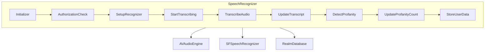

<details>
<summary>Relevant source files</summary>

The following file was used as context for generating this wiki page:

- [Scrumdinger/Models/SpeechRecognizer.swift](https://github.com/aanickode/PottyMouth/blob/main/Scrumdinger/Models/SpeechRecognizer.swift)

</details>

# Speech Recognition Integration

## Introduction

The Speech Recognition Integration feature in this project provides functionality for transcribing speech to text using the `SFSpeechRecognizer` and `AVAudioEngine` classes from the AVFoundation and Speech frameworks. It allows users to start and stop speech recognition, and the transcribed text is continuously updated in real-time. Additionally, it includes functionality for detecting and counting profanity words from the transcribed text, and storing user data related to profanity usage.

The core of the Speech Recognition Integration is implemented in the `SpeechRecognizer` class, which is an `ObservableObject` and an `actor`. This class encapsulates the speech recognition logic and provides a convenient interface for interacting with the feature.

## Architecture Overview

The `SpeechRecognizer` class follows the Actor model introduced in Swift Concurrency, which ensures thread-safe access to its mutable state. It manages the speech recognition process, handles errors, and updates the transcribed text and profanity count accordingly.

Here's a high-level overview of the architecture:



Sources: [Scrumdinger/Models/SpeechRecognizer.swift](https://github.com/aanickode/PottyMouth/blob/main/Scrumdinger/Models/SpeechRecognizer.swift)

## Initialization and Setup

The `SpeechRecognizer` class is initialized with an instance of `SFSpeechRecognizer`. During initialization, it requests authorization to access the speech recognizer and the microphone. If the recognizer is not available or authorization is denied, appropriate errors are handled.

```swift
init() {
    recognizer = SFSpeechRecognizer()
    // ... (omitted for brevity)
    guard recognizer != nil else {
        transcribe(RecognizerError.nilRecognizer)
        return
    }

    Task {
        do {
            guard await SFSpeechRecognizer.hasAuthorizationToRecognize() else {
                throw RecognizerError.notAuthorizedToRecognize
            }
            guard await AVAudioSession.sharedInstance().hasPermissionToRecord() else {
                throw RecognizerError.notPermittedToRecord
            }
        } catch {
            transcribe(error)
        }
    }
}
```

Sources: [Scrumdinger/Models/SpeechRecognizer.swift:36-63](https://github.com/aanickode/PottyMouth/blob/main/Scrumdinger/Models/SpeechRecognizer.swift#L36-L63)

## Speech Recognition Process

The speech recognition process is initiated by calling the `startTranscribing()` method, which in turn calls the `transcribe()` method. This method sets up the `AVAudioEngine` and `SFSpeechAudioBufferRecognitionRequest`, and starts the recognition task using `SFSpeechRecognizer`.

```swift
private func transcribe() {
    guard let recognizer, recognizer.isAvailable else {
        self.transcribe(RecognizerError.recognizerIsUnavailable)
        return
    }

    do {
        let (audioEngine, request) = try Self.prepareEngine()
        self.audioEngine = audioEngine
        self.request = request
        self.task = recognizer.recognitionTask(with: request, resultHandler: { [weak self] result, error in
            self?.recognitionHandler(audioEngine: audioEngine, result: result, error: error)
        })
    } catch {
        self.reset()
        self.transcribe(error)
    }
}
```

Sources: [Scrumdinger/Models/SpeechRecognizer.swift:105-122](https://github.com/aanickode/PottyMouth/blob/main/Scrumdinger/Models/SpeechRecognizer.swift#L105-L122)

The `recognitionHandler` method is called whenever a recognition result or error is received. It handles the final result or error, stops the audio engine, and updates the transcribed text if a result is available.

```swift
nonisolated private func recognitionHandler(audioEngine: AVAudioEngine, result: SFSpeechRecognitionResult?, error: Error?) {
    let receivedFinalResult = result?.isFinal ?? false
    let receivedError = error != nil

    if receivedFinalResult || receivedError {
        audioEngine.stop()
        audioEngine.inputNode.removeTap(onBus: 0)
    }

    if let result {
        transcribe(result.bestTranscription.formattedString)
    }
}
```

Sources: [Scrumdinger/Models/SpeechRecognizer.swift:137-148](https://github.com/aanickode/PottyMouth/blob/main/Scrumdinger/Models/SpeechRecognizer.swift#L137-L148)

## Transcript and Profanity Handling

The `transcribe(_:)` method is responsible for updating the `transcript` property with the transcribed text and detecting profanity words. It also handles storing user data related to profanity usage in the Realm database.

```swift
nonisolated private func transcribe(_ message: String) {
    Task { @MainActor in
        transcript = String(message.lowercased().suffix(max(message.count - lastString.count, 0)))
        let components = transcript.components(separatedBy: " ")
        var map = [String : Int]()
        for word in components {
            if (await profanitySet.contains(word)) {
                if map.keys.contains(word) {
                    map[word]! += 1
                } else {
                    map[word] = 1
                }
                profanityCount = profanityCount + 1
                UIDevice.vibrate()
            }
        }
        if let user = users.first {
            try! realm.write {
                for key in map.keys {
                    user.freqMap[key] = (user.freqMap[key] ?? 0) + map[key]!
                }
                user.totalScore = 0
                for key in user.freqMap.keys {
                    user.totalScore = user.totalScore + (user.freqMap[key] ?? 0)
                }
            }
        }
        lastString = message.lowercased()
    }
}
```

Sources: [Scrumdinger/Models/SpeechRecognizer.swift:151-182](https://github.com/aanickode/PottyMouth/blob/main/Scrumdinger/Models/SpeechRecognizer.swift#L151-L182)

The method performs the following tasks:

1. Updates the `transcript` property with the new transcribed text.
2. Splits the transcript into individual words.
3. Checks each word against the `profanitySet` (retrieved from the Realm database).
4. If a profanity word is found, it updates the `profanityCount` and triggers a device vibration.
5. Stores the frequency of profanity words in the `freqMap` of the user object in the Realm database.
6. Calculates and updates the user's `totalScore` based on the frequency of profanity words.

## Error Handling

The `SpeechRecognizer` class handles various errors that may occur during the speech recognition process. The `transcribe(_:)` method is used to update the `transcript` property with an error message when an error occurs.

```swift
nonisolated private func transcribe(_ error: Error) {
    var errorMessage = ""
    if let error = error as? RecognizerError {
        errorMessage += error.message
    } else {
        errorMessage += error.localizedDescription
    }
    Task { @MainActor [errorMessage] in
        transcript = "<< \(errorMessage) >>"
    }
}
```

Sources: [Scrumdinger/Models/SpeechRecognizer.swift:184-193](https://github.com/aanickode/PottyMouth/blob/main/Scrumdinger/Models/SpeechRecognizer.swift#L184-L193)

The `RecognizerError` enum defines custom error cases related to speech recognition, such as a nil recognizer, lack of authorization, or unavailability of the recognizer.

```swift
enum RecognizerError: Error {
    case nilRecognizer
    case notAuthorizedToRecognize
    case notPermittedToRecord
    case recognizerIsUnavailable
    
    var message: String {
        switch self {
        case .nilRecognizer: return "Can't initialize speech recognizer"
        case .notAuthorizedToRecognize: return "Not authorized to recognize speech"
        case .notPermittedToRecord: return "Not permitted to record audio"
        case .recognizerIsUnavailable: return "Recognizer is unavailable"
        }
    }
}
```

Sources: [Scrumdinger/Models/SpeechRecognizer.swift:10-22](https://github.com/aanickode/PottyMouth/blob/main/Scrumdinger/Models/SpeechRecognizer.swift#L10-L22)

## Data Storage

The `SpeechRecognizer` class interacts with the Realm database to store and retrieve user data related to profanity usage. The `UserInfo` object in the Realm database stores the user's profanity set (`profanitySet`), frequency map of profanity words (`freqMap`), and total score (`totalScore`).

```swift
let realm = try! Realm()
let users: Results<UserInfo>
@MainActor var lastString: String = ""
@MainActor var oldScore: Int = 0
@MainActor var profanitySet: [String] = []
```

Sources: [Scrumdinger/Models/SpeechRecognizer.swift:28-32](https://github.com/aanickode/PottyMouth/blob/main/Scrumdinger/Models/SpeechRecognizer.swift#L28-L32)

During initialization, the `SpeechRecognizer` retrieves the user's profanity set and total score from the Realm database.

```swift
init() {
    // ... (omitted for brevity)
    let savedUsername = UserDefaults.standard.object(forKey: "username") as? String ?? ""
    let savedPassword = UserDefaults.standard.object(forKey: "password") as? String ?? ""
    users = realm.objects(UserInfo.self).where{
        $0.password == savedPassword && $0.username == savedUsername
    }
    if let user = users.first {
        oldScore = user.totalScore
        for word in user.profanitySet {
            profanitySet.append(word)
        }
    }
    // ... (omitted for brevity)
}
```

Sources: [Scrumdinger/Models/SpeechRecognizer.swift:44-56](https://github.com/aanickode/PottyMouth/blob/main/Scrumdinger/Models/SpeechRecognizer.swift#L44-L56)

When profanity words are detected in the transcribed text, the `transcribe(_:)` method updates the user's `freqMap` and `totalScore` in the Realm database.

```swift
if let user = users.first {
    try! realm.write {
        for key in map.keys {
            user.freqMap[key] = (user.freqMap[key] ?? 0) + map[key]!
        }
        user.totalScore = 0
        for key in user.freqMap.keys {
            user.totalScore = user.totalScore + (user.freqMap[key] ?? 0)
        }
    }
}
```

Sources: [Scrumdinger/Models/SpeechRecognizer.swift:171-179](https://github.com/aanickode/PottyMouth/blob/main/Scrumdinger/Models/SpeechRecognizer.swift#L171-L179)

## Conclusion

The Speech Recognition Integration feature in this project provides a comprehensive solution for transcribing speech to text, detecting profanity words, and storing user data related to profanity usage. It leverages the `SFSpeechRecognizer` and `AVAudioEngine` classes from the AVFoundation and Speech frameworks, and integrates with the Realm database for data storage. The `SpeechRecognizer` class encapsulates the core functionality and provides a convenient interface for interacting with the feature.