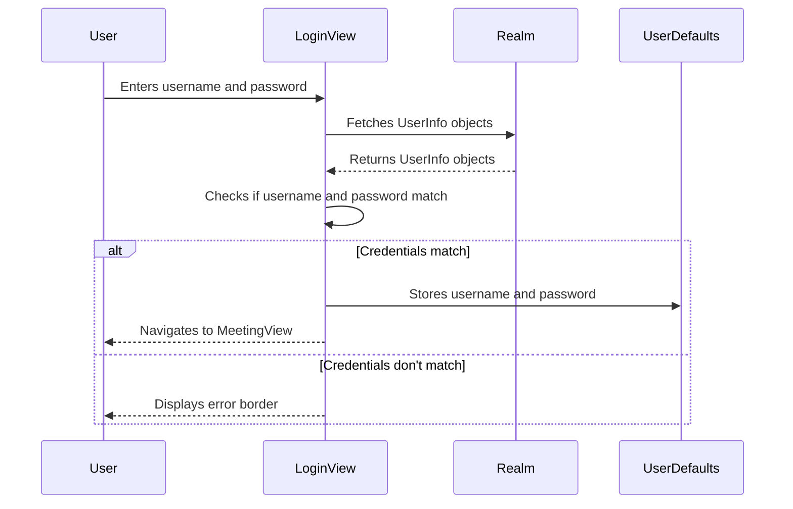
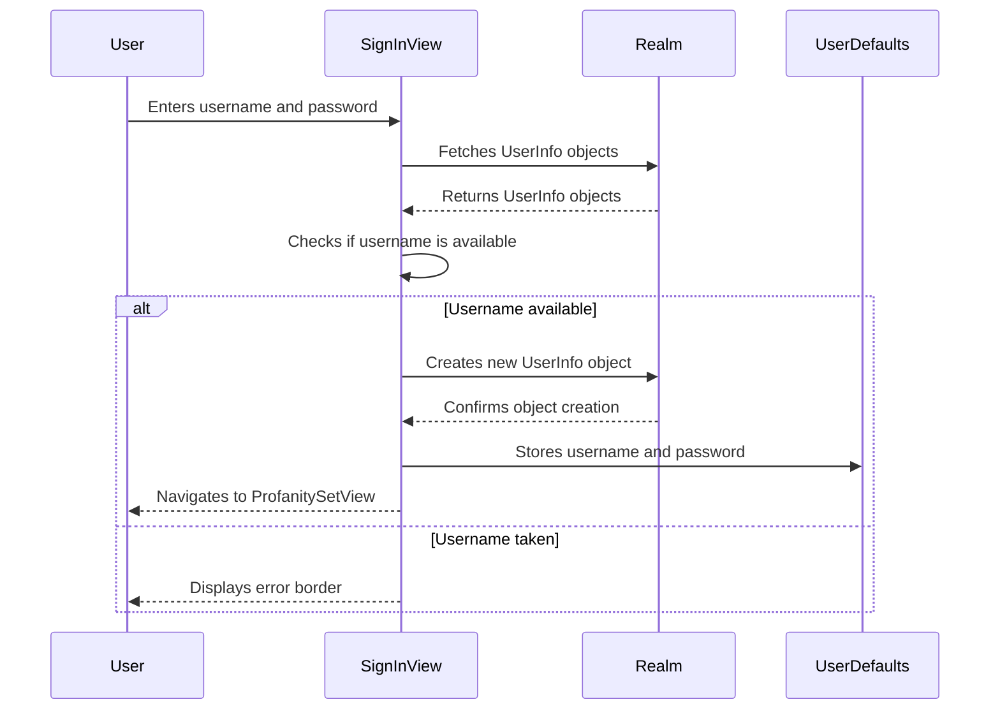

<details>
<summary>Relevant source files</summary>

The following files were used as context for generating this wiki page:

- [Scrumdinger/Models/UserInfo.swift](https://github.com/aanickode/PottyMouth/blob/main/Scrumdinger/Models/UserInfo.swift)
- [Scrumdinger/Views/LoginView.swift](https://github.com/aanickode/PottyMouth/blob/main/Scrumdinger/Views/LoginView.swift)
- [Scrumdinger/Views/SignInView.swift](https://github.com/aanickode/PottyMouth/blob/main/Scrumdinger/Views/SignInView.swift)
</details>

# User Management

## Introduction

The "User Management" feature in the PottyMouth project handles user authentication, registration, and user data storage. It provides functionality for users to log in, create new accounts, and manage their profanity preferences. The user data is stored using the Realm database, ensuring persistence across app sessions.

Sources: [Scrumdinger/Models/UserInfo.swift](), [Scrumdinger/Views/LoginView.swift](), [Scrumdinger/Views/SignInView.swift]()

## User Data Model

The `UserInfo` class, defined in the `UserInfo.swift` file, represents the user data model in the Realm database. It contains the following properties:

- `username`: A string representing the user's username.
- `password`: A string representing the user's password.
- `userId`: A string representing a unique identifier for the user.
- `totalScore`: An integer representing the user's total score (purpose not specified in the provided files).
- `profanitySet`: A list of strings representing the user's preferred profanity words or phrases.
- `freqMap`: A map that stores the frequency of profanity words or phrases used by the user (key: string, value: integer).

```swift
class UserInfo: Object {
    @objc dynamic var username: String = ""
    @objc dynamic var password: String = ""
    @objc dynamic var userId: String = ""
    @objc dynamic var totalScore: Int = 0
    dynamic var profanitySet: List<String> = List<String>()
    dynamic var freqMap: Map<String, Int> = Map()
}
```

Sources: [Scrumdinger/Models/UserInfo.swift:9-16]()

## User Authentication

The `LoginView` struct, defined in the `LoginView.swift` file, handles user authentication. It presents a user interface with text fields for entering the username and password, and buttons for logging in or creating a new account.

### Login Flow

The login flow is implemented in the `checkLogin` function within the `LoginView` struct. Here's a sequence diagram illustrating the login process:



1. The user enters their username and password in the respective text fields.
2. The `LoginView` fetches all `UserInfo` objects from the Realm database.
3. The `LoginView` checks if the entered username and password match any of the `UserInfo` objects.
4. If a match is found, the username and password are stored in `UserDefaults`, and the user is navigated to the `MeetingView`.
5. If no match is found or the username or password fields are empty, an error border is displayed around the text fields.

Sources: [Scrumdinger/Views/LoginView.swift:30-58]()

## User Registration

The `SignInView` struct, defined in the `SignInView.swift` file, handles user registration. It presents a user interface with text fields for entering a new username and password, and a button to proceed to the profanity selection screen.

### Registration Flow

The registration flow is implemented in the `checkLogin` function within the `SignInView` struct. Here's a sequence diagram illustrating the registration process:



1. The user enters a new username and password in the respective text fields.
2. The `SignInView` fetches all `UserInfo` objects from the Realm database.
3. The `SignInView` checks if the entered username is already taken by any existing `UserInfo` object.
4. If the username is available, a new `UserInfo` object is created in the Realm database with the entered username and password.
5. The username and password are stored in `UserDefaults`, and the user is navigated to the `ProfanitySetView`.
6. If the username is already taken, an error border is displayed around the text fields.

Sources: [Scrumdinger/Views/SignInView.swift:30-62]()

## Profanity Management

The `UserInfo` model includes a `profanitySet` property, which is a list of strings representing the user's preferred profanity words or phrases. The provided source files do not contain details on how this profanity set is managed or utilized within the application.

Sources: [Scrumdinger/Models/UserInfo.swift:14]()

## Frequency Tracking

The `UserInfo` model also includes a `freqMap` property, which is a map that stores the frequency of profanity words or phrases used by the user. The key in the map is a string representing the profanity word or phrase, and the value is an integer representing the frequency of usage.

The provided source files do not contain any implementation details on how this frequency map is populated or utilized within the application.

Sources: [Scrumdinger/Models/UserInfo.swift:15]()

## Conclusion

The "User Management" feature in the PottyMouth project provides functionality for user authentication, registration, and storage of user data, including profanity preferences and usage frequencies. The user data is persisted using the Realm database, ensuring data integrity across app sessions. While the provided source files cover the core user management functionality, additional details on profanity management and frequency tracking are not available.