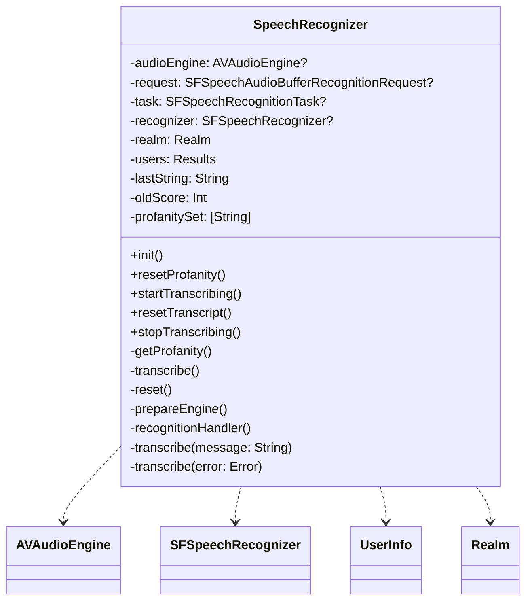
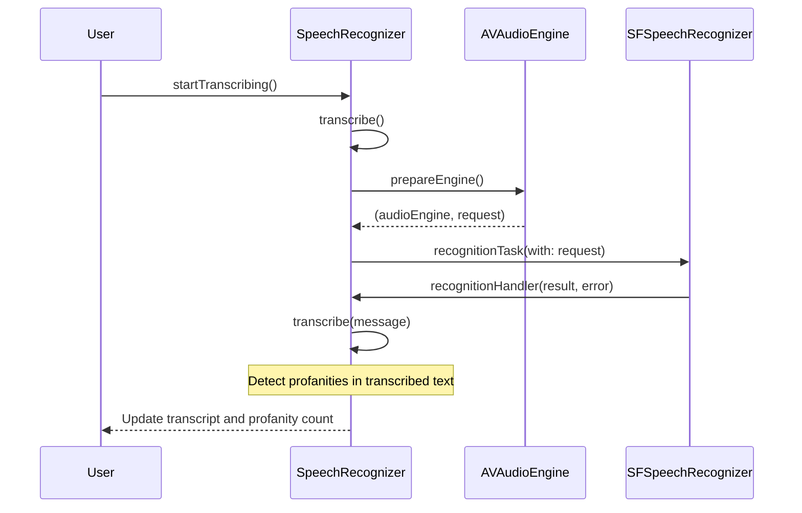
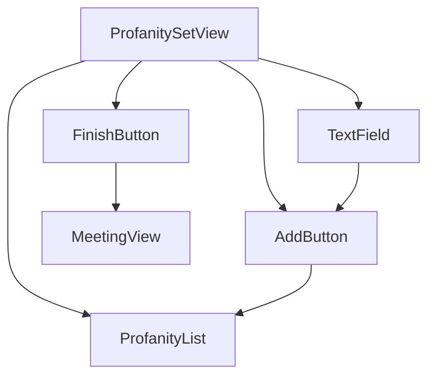
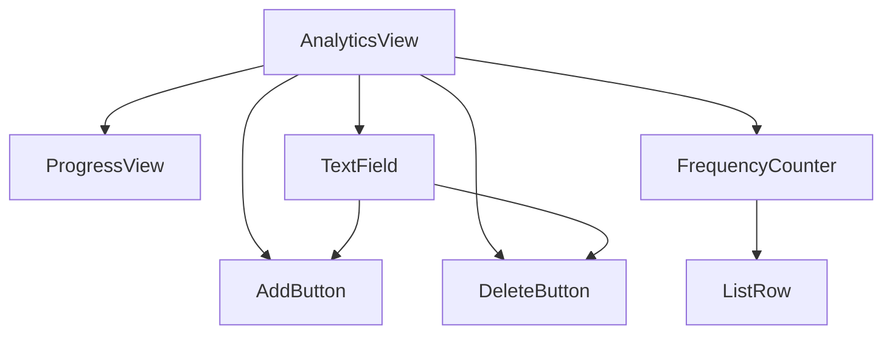

<details>
<summary>Relevant source files</summary>

The following files were used as context for generating this wiki page:

- [Scrumdinger/Models/SpeechRecognizer.swift](https://github.com/aanickode/PottyMouth/blob/main/Scrumdinger/Models/SpeechRecognizer.swift)
- [Scrumdinger/Views/ProfanitySetView.swift](https://github.com/aanickode/PottyMouth/blob/main/Scrumdinger/Views/ProfanitySetView.swift)
- [Scrumdinger/Views/AnalyticsView.swift](https://github.com/aanickode/PottyMouth/blob/main/Scrumdinger/Views/AnalyticsView.swift)
- [Scrumdinger/Models/UserInfo.swift](https://github.com/aanickode/PottyMouth/blob/main/Scrumdinger/Models/UserInfo.swift)
- [Scrumdinger/Views/MeetingView.swift](https://github.com/aanickode/PottyMouth/blob/main/Scrumdinger/Views/MeetingView.swift)

</details>

# Word Tracking

## Introduction

The "Word Tracking" feature in this project is designed to monitor and analyze the usage of profane or inappropriate words during speech recognition. It leverages the `SpeechRecognizer` class to transcribe audio input and detect profanities based on a user-defined set of words. The feature provides real-time feedback, vibration alerts, and analytics to help users track and reduce their usage of profane language.

The key components involved in the "Word Tracking" feature include:

- `SpeechRecognizer`: Responsible for speech recognition, transcription, and profanity detection.
- `ProfanitySetView`: Allows users to define their custom set of profane words.
- `AnalyticsView`: Displays analytics and statistics related to profanity usage.
- `UserInfo`: A Realm data model that stores user information, including profanity sets and usage frequencies.

## Speech Recognition and Profanity Detection

The `SpeechRecognizer` class is an `ObservableObject` that handles speech recognition and profanity detection. It utilizes the `SFSpeechRecognizer` and `AVAudioEngine` frameworks to transcribe audio input into text.

### Architecture



Sources: [Scrumdinger/Models/SpeechRecognizer.swift](https://github.com/aanickode/PottyMouth/blob/main/Scrumdinger/Models/SpeechRecognizer.swift)

The `SpeechRecognizer` class follows the actor model, ensuring thread-safe access to its properties and methods. It initializes the speech recognizer, requests necessary permissions, and sets up the audio engine for recording and transcription.

### Profanity Detection Flow



Sources: [Scrumdinger/Models/SpeechRecognizer.swift:startTranscribing()](https://github.com/aanickode/PottyMouth/blob/main/Scrumdinger/Models/SpeechRecognizer.swift#L52), [Scrumdinger/Models/SpeechRecognizer.swift:transcribe()](https://github.com/aanickode/PottyMouth/blob/main/Scrumdinger/Models/SpeechRecognizer.swift#L73-L102), [Scrumdinger/Models/SpeechRecognizer.swift:recognitionHandler()](https://github.com/aanickode/PottyMouth/blob/main/Scrumdinger/Models/SpeechRecognizer.swift#L124-L133), [Scrumdinger/Models/SpeechRecognizer.swift:transcribe(message:)](https://github.com/aanickode/PottyMouth/blob/main/Scrumdinger/Models/SpeechRecognizer.swift#L135-L173)

The `transcribe(message:)` method is responsible for detecting profanities in the transcribed text. It compares each word in the transcript against the user's profanity set, maintained in the `profanitySet` property. If a profanity is detected, it increments the `profanityCount` and triggers a vibration alert using `UIDevice.vibrate()`. The method also updates the user's profanity usage frequency in the Realm database.

## Profanity Set Management

The `ProfanitySetView` allows users to define their custom set of profane words that should be tracked and monitored during speech recognition.

### User Interface



Sources: [Scrumdinger/Views/ProfanitySetView.swift](https://github.com/aanickode/PottyMouth/blob/main/Scrumdinger/Views/ProfanitySetView.swift)

The `ProfanitySetView` consists of the following components:

- `TextField`: Allows users to input a new profane word.
- `AddButton`: Adds the entered word to the profanity list.
- `FinishButton`: Saves the profanity set and navigates to the `MeetingView`.
- `ProfanityList`: Displays the current list of profane words.

### Profanity Set Persistence

When the user clicks the "Finish" button, the `completeSignUp()` function is called, which saves the profanity set to the Realm database for the current user.

```swift
func completeSignUp() {
    isFinished = true
    let realm = try! Realm(configuration: configuration)
    let savedUsername = UserDefaults.standard.object(forKey: "username") as? String ?? ""
    let savedPassword = UserDefaults.standard.object(forKey: "password") as? String ?? ""
    let users = realm.objects(UserInfo.self).where{
        $0.password == savedPassword && $0.username == savedUsername
    }
    if let user = users.first {
        try! realm.write {
            for word in profanityList {
                user.profanitySet.append(word)
                user.freqMap[word] = 0
            }
        }
    }
}
```

Sources: [Scrumdinger/Views/ProfanitySetView.swift:completeSignUp()](https://github.com/aanickode/PottyMouth/blob/main/Scrumdinger/Views/ProfanitySetView.swift#L56-L70)

The `completeSignUp()` function retrieves the current user from the Realm database and adds each word from the `profanityList` to the user's `profanitySet` and `freqMap` properties, initializing the frequency to 0.

## Analytics and Profanity Tracking

The `AnalyticsView` provides users with insights and statistics related to their profanity usage, allowing them to monitor and manage their language.

### User Interface



Sources: [Scrumdinger/Views/AnalyticsView.swift](https://github.com/aanickode/PottyMouth/blob/main/Scrumdinger/Views/AnalyticsView.swift)

The `AnalyticsView` consists of the following components:

- `ProgressView`: Displays the user's total profanity count relative to a target value (e.g., 50 words).
- `TextField`: Allows users to add or delete profane words from their set.
- `AddButton`: Adds the entered word to the user's profanity set.
- `DeleteButton`: Removes the entered word from the user's profanity set.
- `FrequencyCounter`: Displays a list of profane words and their usage frequencies.

### Profanity Tracking and Analytics

The `AnalyticsView` retrieves the user's profanity set and usage frequencies from the Realm database and displays them in the `FrequencyCounter`. It also calculates the total profanity count and updates the `ProgressView` accordingly.

```swift
func loadFreq() {
    let savedUsername = UserDefaults.standard.object(forKey: "username") as? String ?? ""
    let savedPassword = UserDefaults.standard.object(forKey: "password") as? String ?? ""
    let users = realm.objects(UserInfo.self).where{
        $0.password == savedPassword && $0.username == savedUsername
    }
    if let user = users.first {
        tuples = []
        for key in user.freqMap.keys {
            if let num = user.freqMap[key] {
                tuples.append((num, key))
            }
        }
        totalCount = Double(min(user.totalScore, 50))
    }
    tuples.sort(by: {$0.freq > $1.freq})
}
```

Sources: [Scrumdinger/Views/AnalyticsView.swift:loadFreq()](https://github.com/aanickode/PottyMouth/blob/main/Scrumdinger/Views/AnalyticsView.swift#L55-L67)

The `loadFreq()` function retrieves the current user's `freqMap` and `totalScore` from the Realm database. It populates the `tuples` array with tuples of (frequency, word) and sorts them in descending order of frequency. The `totalCount` is set to the minimum of the user's `totalScore` and a target value of 50, which is used to update the `ProgressView`.

The `addWord(word:)` and `deleteWord(word:)` functions allow users to modify their profanity set by adding or removing words, respectively. These functions update the user's `profanitySet` and `freqMap` in the Realm database.

## Data Model

The `UserInfo` class is a Realm data model that stores user information, including the profanity set and usage frequencies.

```swift
class UserInfo: Object {
    @Persisted(primaryKey: true) var _id: ObjectId
    @Persisted var username: String
    @Persisted var password: String
    @Persisted var profanitySet: List<String>
    @Persisted var freqMap: Map<String, Int>
    @Persisted var totalScore: Int
    
    convenience init(username: String, password: String) {
        self.init()
        self.username = username
        self.password = password
    }
}
```

Sources: [Scrumdinger/Models/UserInfo.swift](https://github.com/aanickode/PottyMouth/blob/main/Scrumdinger/Models/UserInfo.swift)

The `UserInfo` class has the following properties:

- `_id`: The primary key for the object.
- `username`: The user's username.
- `password`: The user's password.
- `profanitySet`: A list of profane words defined by the user.
- `freqMap`: A map that stores the usage frequency of each profane word.
- `totalScore`: The total count of profanities used by the user.

The `profanitySet` and `freqMap` properties are used by the `SpeechRecognizer` and `AnalyticsView` to manage and display the user's profanity data.

## Conclusion

The "Word Tracking" feature in this project provides a comprehensive solution for monitoring and analyzing the usage of profane or inappropriate words during speech recognition. It leverages the `SpeechRecognizer` class for transcription and profanity detection, the `ProfanitySetView` for managing the user's profanity set, and the `AnalyticsView` for displaying analytics and statistics related to profanity usage. The feature also utilizes the `UserInfo` data model in Realm to persist user information, profanity sets, and usage frequencies. Overall, this feature aims to help users become more aware of their language and reduce the use of profane words.