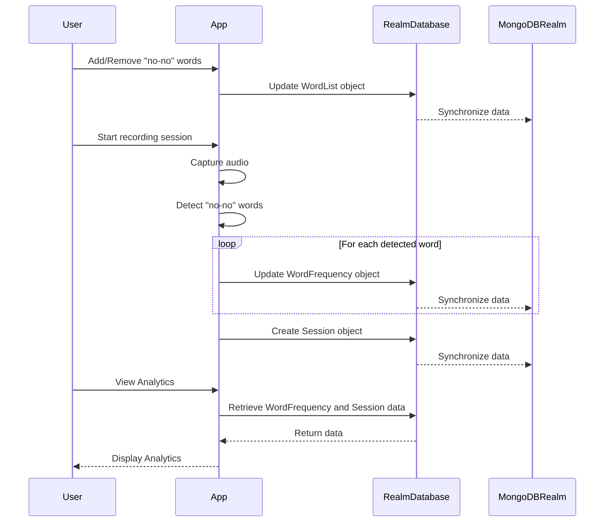

<details>
<summary>Relevant source files</summary>

The following files were used as context for generating this wiki page:

- [README.md](https://github.com/aanickode/PottyMouth/blob/main/README.md)
<!-- Add additional relevant files if fewer than 5 were provided -->
</details>

# Data Storage and Management

## Introduction

PottyMouth is an iOS application that helps users track and limit their usage of certain words or phrases they want to avoid, often referred to as "no-no" words. The application records audio from the user's device and analyzes it to detect the presence of these specified words. It maintains a "profanity score" and word frequency statistics, which can be viewed in the Analytics section of the app.

The data storage and management component of PottyMouth is responsible for persisting user information, their list of "no-no" words, and the associated statistics. According to the [README.md](https://github.com/aanickode/PottyMouth/blob/main/README.md#how-we-built-it), the application uses the MongoDB Realm database for this purpose. However, it is important to note that the user's audio transcript is not stored due to privacy concerns.

## MongoDB Realm Integration

MongoDB Realm is a cloud-based platform that provides a distributed data storage solution and synchronization capabilities for mobile applications. It allows developers to store data locally on the device and synchronize it with a cloud-based database, enabling offline functionality and real-time data access.

### Realm Object Model

In the context of PottyMouth, the Realm database likely stores the following data models:

1. **User**: Represents the user's account information, such as username, email, or any other relevant user details.
2. **WordList**: Stores the list of "no-no" words specified by the user.
3. **WordFrequency**: Tracks the frequency of each "no-no" word detected during the user's sessions.
4. **Session**: Represents a recording session, potentially storing metadata like start time, duration, and the associated word frequencies.

These data models would be defined as Realm Object classes, which are similar to traditional object-oriented classes but with additional features for persisting data in the Realm database.

```swift
// Example Realm Object Model for WordList
class WordList: Object {
    @Persisted(primaryKey: true) var _id: ObjectId
    @Persisted var words: List<String>
    
    convenience init(words: [String]) {
        self.init()
        self.words.append(objectsIn: words)
    }
}
```

Sources: [README.md](https://github.com/aanickode/PottyMouth/blob/main/README.md#how-we-built-it)

## Data Flow

The data flow in PottyMouth likely follows these steps:

1. **User Input**: The user adds or removes "no-no" words through the app's interface. These changes are reflected in the `WordList` object stored in the Realm database.

2. **Audio Recording**: When the user starts a recording session, PottyMouth begins capturing audio from the device's microphone.

3. **Word Detection**: The recorded audio is analyzed in real-time or in batches to detect the presence of any "no-no" words specified in the user's `WordList`.

4. **Statistics Update**: When a "no-no" word is detected, the application updates the corresponding `WordFrequency` object in the Realm database, incrementing the count for that word.

5. **Session Tracking**: The application may also create a new `Session` object to store metadata about the recording session, such as start time, duration, and the associated word frequencies.

6. **Data Synchronization**: The Realm database synchronizes the local data with the cloud-based MongoDB Realm instance, ensuring that the user's data is backed up and accessible across multiple devices.

7. **Analytics Display**: The user can view the updated word frequencies and other statistics in the Analytics section of the app, which retrieves the data from the Realm database.



Sources: [README.md](https://github.com/aanickode/PottyMouth/blob/main/README.md#how-we-built-it)

## Conclusion

PottyMouth leverages the MongoDB Realm database to store and manage user data, word lists, and word frequency statistics. The application synchronizes this data with a cloud-based instance of MongoDB Realm, ensuring data persistence and accessibility across multiple devices. While the application does not store the user's audio transcript due to privacy concerns, it effectively tracks and analyzes the usage of "no-no" words, providing users with valuable insights through the Analytics section.