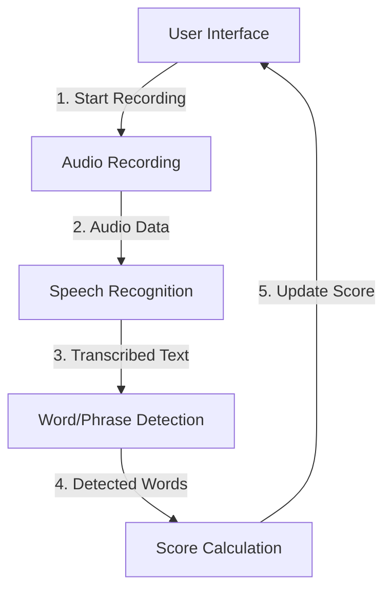
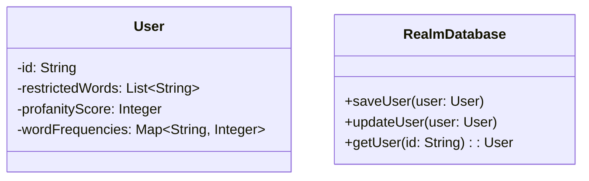
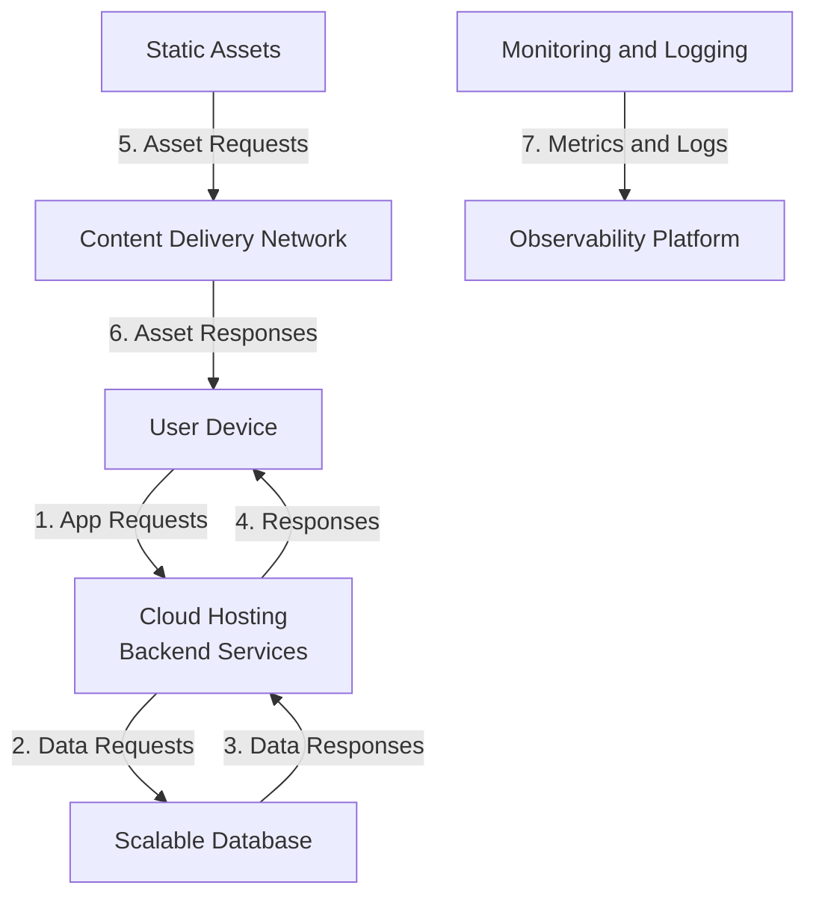

Relevant source files

The following files were used as context for generating this wiki page:

- [README.md](https://github.com/aanickode/PottyMouth/blob/main/README.md)

# Deployment and Infrastructure

## Introduction

PottyMouth is an iOS application built using Swift that aims to help users limit their usage of certain words or phrases they want to avoid, often referred to as "no-no" words. The application records audio from the user's device microphone, with their permission, and analyzes the speech to detect occurrences of the specified words or phrases. It maintains a "profanity score" that increments each time a restricted word is detected, and also tracks the frequency of each individual word or phrase. The application provides an Analytics section where users can view the frequency of each restricted word, add or remove words from their list, and potentially view a leaderboard or donate to charities based on their score (planned future features).

The application utilizes the MongoDB Realm database to store user information, but does not store the user's speech transcript for privacy reasons. The deployment and infrastructure details for PottyMouth are not explicitly provided in the given source file, but some inferences can be made based on the information available.

## Application Architecture

Based on the provided information, PottyMouth appears to follow a typical mobile application architecture, with the following components:

### 1. User Interface (UI)

The application likely has a user interface built using Swift's UIKit framework or SwiftUI, which allows users to interact with the application's features, such as:

- Configuring the list of restricted words or phrases
- Viewing the "profanity score" and word frequencies
- Accessing the Analytics section
- Potentially integrating with other services like Venmo (planned future feature)

### 2. Audio Recording and Speech Recognition

PottyMouth requires access to the device's microphone to record the user's speech. It likely utilizes Apple's Speech Recognition APIs or third-party libraries to convert the recorded audio into text and perform word/phrase detection against the user's configured list.

Sources: [README.md](https://github.com/aanickode/PottyMouth/blob/main/README.md)

### 3. Data Storage

The application uses the MongoDB Realm database to store user information, such as the list of restricted words or phrases, and potentially other user-specific data. However, it does not store the user's speech transcript for privacy reasons.

Sources: [README.md](https://github.com/aanickode/PottyMouth/blob/main/README.md)

## Deployment and Infrastructure (Inferred)

While the provided source file does not explicitly mention deployment or infrastructure details, we can make some inferences based on the application's nature and target platform:

### 1. App Distribution

As an iOS application, PottyMouth is likely distributed through the Apple App Store. This would involve the following steps:

1. Registering as an Apple Developer
2. Creating an App Store Connect account
3. Building and archiving the application using Xcode
4. Submitting the application for review
5. Releasing the approved application on the App Store

### 2. Infrastructure (Inferred)

The infrastructure requirements for PottyMouth would depend on the scale and usage of the application. For a small-scale or personal use case, the following infrastructure might be sufficient:

- **MongoDB Realm**: The application uses the MongoDB Realm database to store user information. Realm provides a cloud-hosted database service that can be used without additional infrastructure setup.

However, if the application gains widespread adoption or plans to incorporate features like leaderboards or charity integrations, a more robust infrastructure might be required:

- **Cloud Hosting**: The application's backend services, such as leaderboard management, charity integrations, or user authentication, could be hosted on a cloud platform like AWS, Google Cloud, or Azure.
- **Scalable Database**: A scalable database solution, such as a managed MongoDB cluster or a relational database service, might be needed to handle larger amounts of user data and traffic.
- **Content Delivery Network (CDN)**: A CDN could be used to improve the delivery of static assets, such as images or other resources, to users globally.
- **Monitoring and Logging**: Tools for monitoring application performance, error logging, and analytics would be beneficial for maintaining and improving the application.

Sources: [README.md](https://github.com/aanickode/PottyMouth/blob/main/README.md) (Inferred based on typical mobile app deployment and infrastructure practices)

## Conclusion

PottyMouth is an iOS application that helps users limit their usage of certain words or phrases by recording their speech, detecting occurrences of restricted words, and providing analytics on word frequencies and a "profanity score." The application utilizes the MongoDB Realm database to store user information and follows a typical mobile app architecture with components for user interface, audio recording, speech recognition, and data storage. While deployment and infrastructure details are not explicitly provided, the application is likely distributed through the Apple App Store, and its infrastructure requirements would depend on the scale and usage, potentially involving cloud hosting, scalable databases, CDNs, and monitoring tools for larger-scale deployments.