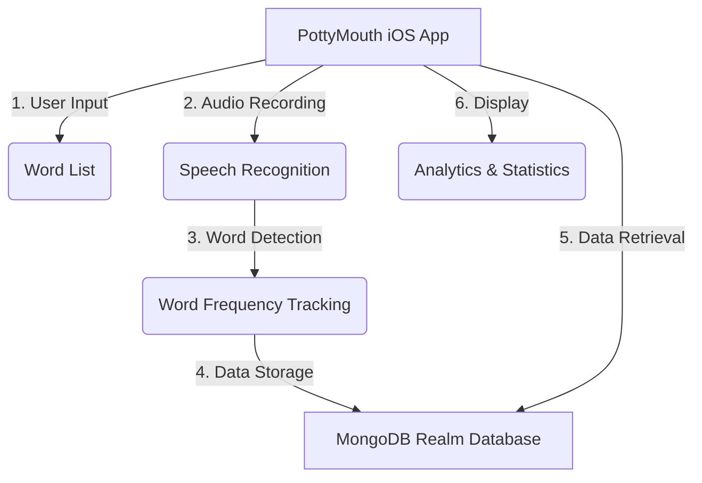
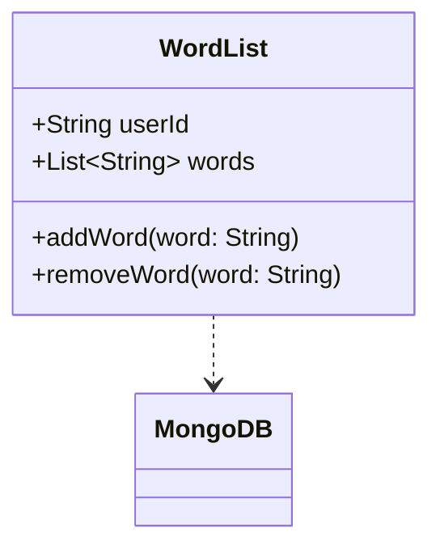
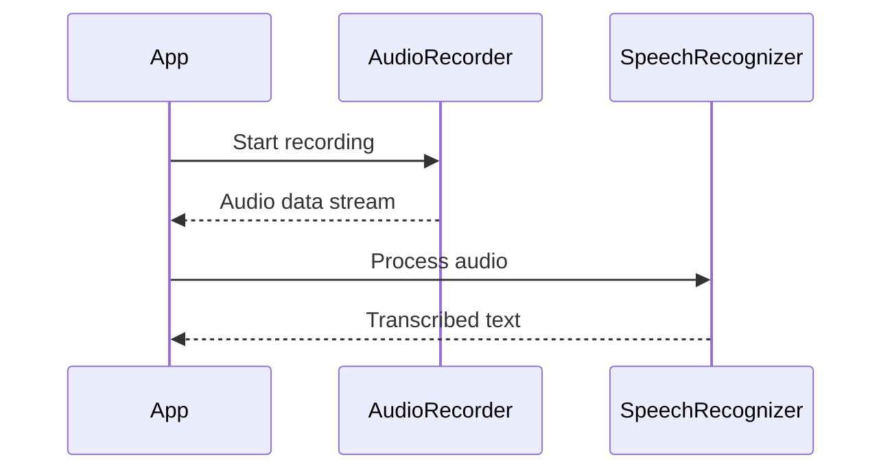
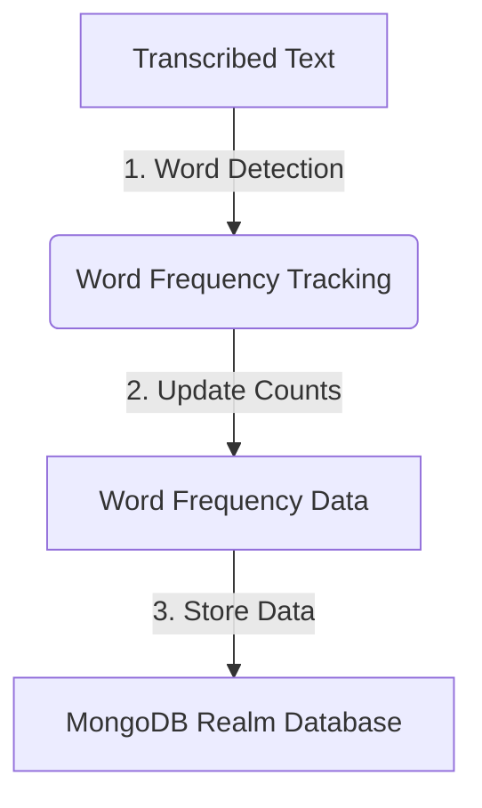
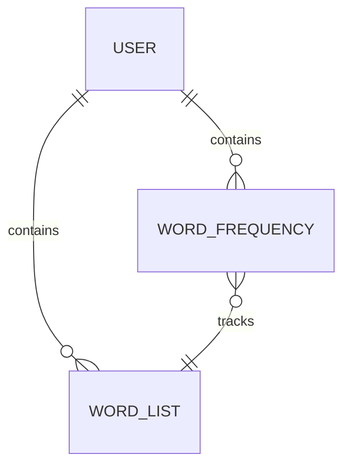

Relevant source files

The following file was used as context for generating this wiki page:

- [README.md](https://github.com/aanickode/PottyMouth/blob/main/README.md)

# Getting Started

## Introduction

PottyMouth is an iOS application designed to help users monitor and limit their use of certain words or phrases they want to avoid, often referred to as "no-no" words. The app records audio through the device's microphone and analyzes the user's speech to detect the occurrence of these specified words. It then provides analytics and statistics on the frequency of usage for each word, allowing users to track their progress and improve their speaking habits.

The primary use cases for PottyMouth include:

- Household settings, where parents can use it as a digital "swear jar" to discourage the use of profanity or inappropriate language by family members.
- Educational contexts, where students and teachers can improve their public speaking skills and classroom etiquette by avoiding filler words like "like," "very," or "uhm."
- Social gatherings or parties, where users can monitor and limit their use of certain words or phrases.

## Application Architecture

The PottyMouth application is built using Swift for iOS devices. It leverages the device's microphone for audio recording and performs on-device speech recognition and analysis to detect the user's specified "no-no" words.

Sources: [README.md](https://github.com/aanickode/PottyMouth/blob/main/README.md)

## Word List Management

Users can add or remove words from their "no-no" word list through the application's interface. This list is stored in the MongoDB Realm database, allowing users to customize the words they want to monitor and track.

Sources: [README.md](https://github.com/aanickode/PottyMouth/blob/main/README.md)

## Audio Recording and Speech Recognition

With the user's permission, PottyMouth records audio through the device's microphone. The recorded audio is then processed using on-device speech recognition to transcribe the user's speech into text.

Sources: [README.md](https://github.com/aanickode/PottyMouth/blob/main/README.md)

## Word Detection and Frequency Tracking

The transcribed text is analyzed to detect the occurrence of words from the user's "no-no" word list. Each time a word is detected, its frequency count is incremented, and the overall "profanity score" is updated.

Sources: [README.md](https://github.com/aanickode/PottyMouth/blob/main/README.md)

## Data Storage and Privacy

PottyMouth stores user information, including the word list and frequency data, in the MongoDB Realm database. However, to protect user privacy, the application does not store the actual audio recordings or transcripts.

Sources: [README.md](https://github.com/aanickode/PottyMouth/blob/main/README.md)

## Analytics and Statistics

The application provides an "Analytics" section where users can view the frequency of usage for each word in their "no-no" list. This allows users to track their progress and identify words they need to focus on avoiding.

| Feature | Description |
| --- | --- |
| Word Frequency | Displays the number of times each word was detected during the recording session. |
| Profanity Score | Shows the total count of "no-no" word occurrences. |
| Word List Management | Allows users to add or remove words from their "no-no" list. |

Sources: [README.md](https://github.com/aanickode/PottyMouth/blob/main/README.md)

## Conclusion

PottyMouth is an iOS application that helps users monitor and limit their use of certain words or phrases through audio recording, speech recognition, and frequency tracking. By providing analytics and statistics, the app aims to improve users' speaking habits in various contexts, such as households, educational settings, and social gatherings.

Sources: [README.md](https://github.com/aanickode/PottyMouth/blob/main/README.md)