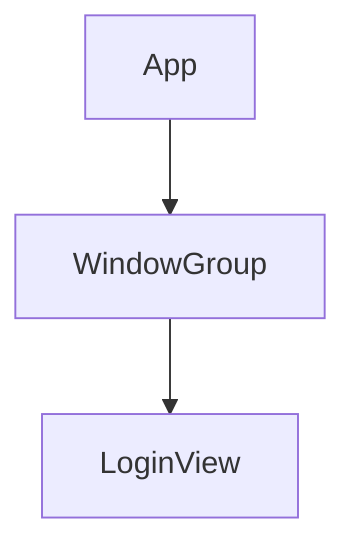

<details>
<summary>Relevant source files</summary>

The following file was used as context for generating this wiki page:

- [Scrumdinger/ScrumdingerApp.swift](https://github.com/aanickode/PottyMouth/blob/main/Scrumdinger/ScrumdingerApp.swift)

</details>

# Architecture Overview

## Introduction

The Scrumdinger app is a SwiftUI-based application built for iOS devices. The provided source file, `ScrumdingerApp.swift`, serves as the entry point for the application and sets up the initial view to be displayed. This file contains the `ScrumdingerApp` struct, which conforms to the `App` protocol and defines the app's scene and window configuration.

## App Entry Point

### `ScrumdingerApp` Struct

The `ScrumdingerApp` struct is the main entry point for the Scrumdinger application. It inherits from the `App` protocol, which is a part of the SwiftUI framework and is responsible for defining the app's behavior and initial view.

```swift
@main
struct ScrumdingerApp: App {
    // ...
}
```

Sources: [ScrumdingerApp.swift:7-9]()

## App Scene Configuration

The `ScrumdingerApp` struct overrides the `body` computed property, which is required by the `App` protocol. This property returns a `Scene` instance that represents the app's user interface.

```swift
var body: some Scene {
    WindowGroup {
        LoginView()
    }
}
```

Sources: [ScrumdingerApp.swift:11-15]()

### `WindowGroup`

The `WindowGroup` is a type of `Scene` that represents a group of windows or screens in the app. In this case, it contains a single window that displays the `LoginView`.



Sources: [ScrumdingerApp.swift:13-14]()

### `LoginView`

The `LoginView` is a SwiftUI view that is set as the initial view to be displayed when the app launches. This view is likely responsible for handling user authentication or login functionality.

```swift
LoginView()
```

Sources: [ScrumdingerApp.swift:14]()

## Conclusion

The `ScrumdingerApp.swift` file serves as the entry point for the Scrumdinger application. It sets up the app's scene configuration and specifies the `LoginView` as the initial view to be displayed. While this file provides a basic understanding of the app's architecture, further exploration of the codebase would be required to gain a more comprehensive understanding of the application's functionality and features.